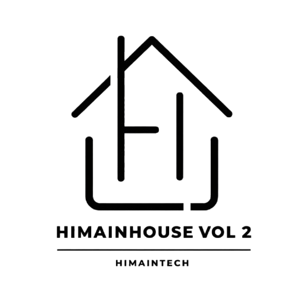

# DAIFA — Personal Portfolio & Web Development Teaching Kit
### 🚀 Official Workshop Project: HIMAINHOUSE VOL. 2 (Branch: `modular`)

<p align="center">
  
  
  
</p>

<p align="center">
  <strong>Diselenggarakan Oleh:</strong><br>
  <strong>Program Studi Informatika Universitas Teknologi Digital</strong> &bull; 
  <strong>HIMA INTECH</strong> (Himpunan Mahasiswa Informatika Digitech) &bull; 
  <strong>HIMAINHOUSE VOL. 2</strong>
</p>

---

## 🌿 Struktur & Panduan Branch Repositori

Repositori ini dikelola dengan strategi multi-branch yang terstruktur untuk memisahkan materi workshop, deployment hosting, dan pembelajaran clean code/arsitektur modular:

| Nama Branch | Peran & Deskripsi | Tautan Akses Langsung |
| :--- | :--- | :--- |
| **`main`** ⭐ | **Repositori Master & Materi Lengkap**: Menyimpan seluruh materi ajar workshop (*slide presentasi visual Marp*, modul materi WPU, panduan Git & GitHub Pages, serta PDF presentasi) bersama kode portofolio utama. | [Lihat Branch `main` ↗](https://github.com/daifa-maulana/Himainhouse/tree/main) |
| **`gh-pages`** 🚀 | **Production Live Hosting**: Branch khusus yang dideploy otomatis oleh GitHub Pages untuk menyajikan website secara publik di internet. Berisi aset produksi murni tanpa dokumen presentasi/modul agar ringan dan cepat diakses. | [Lihat Branch `gh-pages` ↗](https://github.com/daifa-maulana/Himainhouse/tree/gh-pages)<br>🌐 **Live Web:** [daifa-maulana.github.io/Himainhouse](https://daifa-maulana.github.io/Himainhouse/) |
| **`modular`** 🧩 | **Clean Architecture & Modular Components** *(Branch ini)*: Versi arsitektur rapi di mana file HTML, CSS, dan JavaScript dipecah menjadi komponen-komponen mandiri (`components/*.html`, `assets/css/sections/`, `assets/js/modules/`). Sangat ideal untuk mempelajari konsep *Separation of Concerns* (SoC) dan *Component Pattern*. | [Lihat Branch `modular` ↗](https://github.com/daifa-maulana/Himainhouse/tree/modular) |

### 📌 Cara Berpindah Antar Branch di Terminal Git:
```bash
# 1. Pindah ke branch materi utama (Slide presentasi & modul ajar)
git checkout main

# 2. Pindah ke branch live hosting GitHub Pages
git checkout gh-pages

# 3. Pindah ke branch kode modular (HTML components, modular CSS & JS)
git checkout modular
```

---

## 🌟 Tentang Branch `modular`

Branch **`modular`** dirancang khusus untuk pembelajaran **Clean Code & Component-Based Architecture** menggunakan **HTML, CSS, dan Vanilla JavaScript murni** tanpa bundler atau framework yang rumit. 

Dengan memecah kode besar menjadi modul-modul kecil per section (misal: *About, Work, Hero, Certificates*), siswa dapat memahami konsep **Separation of Concerns (SoC)**, kemudahan *maintenance*, dan kesiapan migrasi ke library/framework modern (seperti React, Vue, atau Astro) di masa mendatang.

---

## 📁 Struktur Berkas Modular

```text
DAIFA_Portfolio_Layout_Refined/
├── index.html                       # Hub dokumen semantik utama
├── README.md                        # Dokumentasi arsitektur modular & glosarium
│
├── components/                      # 🧩 Partial HTML Components per Section
│   ├── header.html                  # Frosted glass dock & mobile toggle
│   ├── hero.html                    # Hero typography & avatar layout
│   ├── about.html                   # Story narrative & 3 core pillars
│   ├── work.html                    # 3-column project showcase cards
│   ├── certificates.html            # Google for Education credential & rainbow accent
│   ├── expertise.html               # 3 technical disciplines & skill tags
│   ├── journey.html                 # Academic & learning milestone timeline
│   ├── organizers.html              # HIMAINHOUSE VOL. 2 event organizers
│   ├── contact.html                 # Dark contact card & copy clipboard
│   └── footer.html                  # Back to top, organizer logos, copyright
│
└── assets/
    ├── css/
    │   ├── style.css                # Master CSS Hub (Mengorkestrasi seluruh CSS via @import)
    │   ├── base/                    # Fondasi global CSS
    │   │   ├── variables.css        # Design tokens (:root colors, typography, radii)
    │   │   ├── reset.css            # CSS reset, body background, skip-link
    │   │   ├── animations.css       # Keyframes & scroll reveal classes
    │   │   └── responsive.css       # Breakpoints tablet (992px) & mobile (680px)
    │   ├── components/              # Komponen antarmuka yang dapat digunakan berulang
    │   │   ├── dock.css             # Liquid glass dock & navbar
    │   │   ├── buttons.css          # Pill, glass, & solid button styles
    │   │   └── footer.css           # Centered footer & 64px logos
    │   └── sections/                # Modul CSS spesifik per bagian halaman
    │       ├── hero.css             # Asymmetric layout & backdrop typography
    │       ├── about.css            # Narrative typography & pillar cards
    │       ├── work.css             # Project cards grid & aspect ratios
    │       ├── certificates.css     # Rainbow accent Google Gemini & stats card
    │       ├── expertise.css        # 3-column discipline layout
    │       ├── journey.css          # Milestones list & year badges
    │       ├── organizers.css       # Event cards & organizer logos
    │       └── contact.css          # Dark container & clipboard feedback
    │
    └── js/
        ├── script.js                # Master JS Orchestrator (Mengaktifkan seluruh modul)
        └── modules/                 # Modul JavaScript murni terisolasi
            ├── dock.js              # Mobile menu drawer & dynamic scroll blur
            ├── scrollspy.js         # IntersectionObserver active nav link
            ├── reveal.js            # Scroll reveal fade-in animations & a11y
            ├── clipboard.js         # Copy email to clipboard & visual feedback
            └── year.js              # Automatic dynamic copyright year
```

---

## 💡 Mengapa Menggunakan Arsitektur Modular?

1. **Zero-Build Requirement**: Modul CSS dihubungkan langsung menggunakan `@import` asli browser, dan JavaScript dirancang bekerja langsung baik dibuka via klik ganda lokal (`file://`) maupun via web server (GitHub Pages).
2. **Skalabilitas**: Jika ingin mengubah gaya section *Certificates*, pemateri/peserta cukup membuka `assets/css/sections/certificates.css` tanpa khawatir merusak section lain.
3. **Keterbacaan (Readability)**: Setiap berkas berkisar antara 40 hingga 150 baris kode bersih yang padat dan terdokumentasi rapi.
4. **Kompatibilitas Standar Industri**: Membiasakan siswa dengan pola arsitektur yang sama seperti Tailwind/PostCSS, SASS, dan *component directory structure* di dunia kerja.

---

## 📖 Kamus & Glosarium Istilah Web Development

### 1. Istilah HTML & Struktur Web
* **Semantic HTML**: Penggunaan tag HTML yang memiliki makna sesuai fungsinya (`<header>`, `<nav>`, `<main>`, `<section>`, `<article>`, `<figure>`, `<footer>`).
* **Component-Based Thinking**: Memandang sebuah halaman web sebagai susunan dari komponen-komponen mandiri yang dapat dirakit (*composed*).
* **Skip Link**: Tautan aksesibilitas tersembunyi yang memungkinkan pengguna navigasi keyboard melompat langsung ke konten utama (`#main-content`).

### 2. Istilah CSS & Desain Antarmuka
* **CSS `@import`**: Aturan CSS untuk mengimpor lembar gaya eksternal ke dalam satu berkas hub (`style.css`), menjaga kode tetap terorganisir.
* **Design Tokens (`:root`)**: Variabel desain atomik terpusat (palet warna, jarak, font, radius) untuk konsistensi visual.
* **Glassmorphism**: Efek permukaan kaca buram dengan `backdrop-filter: blur(20px)` dan warna transparan halus.
* **CSS Grid & Flexbox**: Flexbox untuk penataan satu dimensi (seperti baris dock navbar) dan Grid untuk tata letak dua dimensi (seperti grid 3-kolom kartu proyek).

### 3. Istilah JavaScript & Modularitas
* **Module Pattern**: Pola desain memisahkan tanggung jawab kode ke dalam unit-unit independen (`modules/dock.js`, `modules/scrollspy.js`, dll.).
* **IntersectionObserver API**: API browser modern untuk mendeteksi visibilitas elemen di layar dengan performa CPU tinggi tanpa lag saat scrolling.
* **Progressive Enhancement**: Konsep memastikan situs tetap dapat dibaca 100% meskipun JavaScript dimatikan oleh pengguna.

---

## 🚀 Cara Menjalankan Branch Ini

1. **Buka Langsung**: Klik ganda pada berkas `index.html` di browsermu. Seluruh CSS dan JavaScript modular akan langsung aktif.
2. **Beralih Branch di Git**:
   * Gunakan `git checkout main` untuk melihat materi workshop lengkap.
   * Gunakan `git checkout gh-pages` untuk melihat berkas deployment live.
   * Gunakan `git checkout modular` untuk melihat arsitektur kode modular ini.
