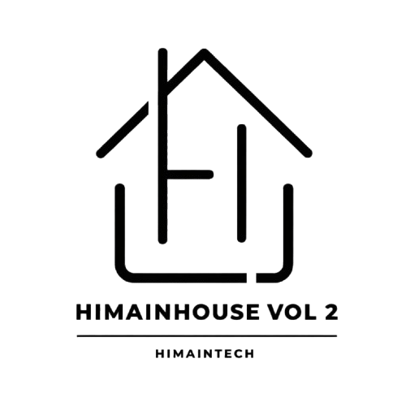

---
# ============================================================
# SLIDES WORKSHOP — HIMAINHOUSE VOL. 2
# Format : Marp (Markdown Presentation Ecosystem)
# Tema   : Putih bersih, minimalis, tipografi tegas
# Ekspor : PDF / PPTX via Marp CLI atau ekstensi VS Code Marp
#
# Cara pakai di VS Code:
# 1. Install ekstensi "Marp for VS Code"
# 2. Buka file ini
# 3. Klik ikon preview (pojok kanan atas) atau Ctrl+Shift+P → Marp: Export Slide Deck
# ============================================================
marp: true
theme: default
paginate: true
backgroundColor: #ffffff
color: #141713
style: |

  /* ── Google Font ── */
  @import url('https://fonts.googleapis.com/css2?family=Plus+Jakarta+Sans:wght@400;500;600;700;800&display=swap');

  /* ── Global ── */
  section {
    font-family: 'Plus Jakarta Sans', -apple-system, sans-serif;
    padding: 48px 56px;
    font-size: 22px;
    line-height: 1.6;
    background: #ffffff;
    color: #141713;
  }

  /* ── Slide Judul (Cover) — kelas khusus ── */
  section.cover {
    display: flex;
    flex-direction: column;
    align-items: flex-start;
    justify-content: flex-end;
    padding-bottom: 56px;
  }

  /* ── Nomor Halaman ── */
  section::after {
    font-size: 12px;
    color: #b0b8ab;
    font-weight: 500;
  }

  /* ── Judul Utama (h1) ── */
  h1 {
    font-size: 44px;
    font-weight: 800;
    letter-spacing: -0.03em;
    line-height: 1.1;
    color: #141713;
    margin: 0 0 12px;
  }

  /* ── Judul Seksi (h2) ── */
  h2 {
    font-size: 30px;
    font-weight: 700;
    letter-spacing: -0.02em;
    color: #141713;
    margin: 0 0 20px;
    padding-bottom: 12px;
    border-bottom: 1.5px solid #e8ebe3;
  }

  /* ── Sub Judul (h3) ── */
  h3 {
    font-size: 20px;
    font-weight: 700;
    color: #485c44;
    margin: 16px 0 8px;
  }

  /* ── Teks & List ── */
  p { font-size: 20px; color: #3d4239; margin: 0 0 10px; }
  li { font-size: 20px; color: #3d4239; margin-bottom: 7px; }
  ul, ol { margin: 4px 0 12px; padding-left: 24px; }

  /* ── Kode inline ── */
  code {
    background: #f0f3ec;
    color: #374734;
    padding: 2px 7px;
    border-radius: 5px;
    font-size: 0.85em;
    font-weight: 600;
    font-family: 'JetBrains Mono', 'Fira Code', monospace;
  }

  /* ── Blok kode ── */
  pre {
    background: #1a1d19;
    border-radius: 10px;
    padding: 16px 20px;
    margin: 10px 0;
  }
  pre code {
    background: transparent;
    color: #d4f0c8;
    padding: 0;
    font-size: 0.76em;
    line-height: 1.55;
  }

  /* ── Blockquote / Catatan ── */
  blockquote {
    background: #f5f7f2;
    border-left: 3px solid #485c44;
    border-radius: 0 8px 8px 0;
    padding: 10px 18px;
    margin: 12px 0;
    color: #3d4239;
    font-size: 19px;
  }
  blockquote p { font-size: 19px; margin: 0; }

  /* ── Tabel ── */
  table {
    width: 100%;
    border-collapse: collapse;
    font-size: 17px;
  }
  th {
    background: #f0f3ec;
    color: #374734;
    font-weight: 700;
    padding: 9px 14px;
    text-align: left;
  }
  td { padding: 8px 14px; border-bottom: 1px solid #eaede6; }
  tr:last-child td { border-bottom: none; }

  /* ── Badge Kecil di Atas Konten ── */
  .label {
    display: inline-block;
    font-size: 11px;
    font-weight: 700;
    letter-spacing: 0.08em;
    text-transform: uppercase;
    color: #485c44;
    background: #eef3ea;
    padding: 3px 10px;
    border-radius: 100px;
    margin-bottom: 10px;
  }

  /* ── Baris Logo Penyelenggara ── */
  .logo-row {
    display: flex;
    align-items: center;
    gap: 20px;
    margin: 24px 0 16px;
  }
  .logo-row img { height: 64px; object-fit: contain; }
  .logo-row .logo-round { border-radius: 50%; }

  /* ── Chip Perintah Git ── */
  .cmd { font-family: monospace; font-weight: 700; color: #485c44; }
---

<!-- ════════════════════════════════════════════════════════
     SLIDE 1 — COVER
     Slide pembuka dengan identitas acara & 3 logo penyelenggara
     ════════════════════════════════════════════════════════ -->

<div class="label">HIMAINHOUSE VOL. 2 — Workshop Series</div>

# Workshop Git & GitHub
## Dari Nol Hingga Portofolio Live Gratis 100%

<div class="logo-row">
  
  
  
</div>

Program Studi Informatika · HIMA INTECH · Universitas Teknologi Digital
*Rujukan: Seri Video WPU — Sandhika Galih*

---

<!-- ════════════════════════════════════════════════════════
     SLIDE 2 — ROADMAP
     Gambaran besar urutan materi yang akan dipelajari hari ini
     ════════════════════════════════════════════════════════ -->

## Alur Belajar Hari Ini

1. **Masalah** — Kenapa butuh Git?
2. **Konsep** — Git vs GitHub (bedanya apa?)
3. **Setup** — Instalasi & konfigurasi identitas
4. **Local Git** — `init` → `add` → `commit` → `log`
5. **Branching** — Cabang kode & penggabungan
6. **Remote** — Hubungkan laptop ke GitHub
7. **Hosting** — Website live via GitHub Pages ✨
8. **Daily Workflow** — Rutinitas 3 perintah sehari-hari

---

<!-- ════════════════════════════════════════════════════════
     SLIDE 3 — MASALAH NYATA
     Memancing empati peserta sebelum masuk ke solusi
     ════════════════════════════════════════════════════════ -->

## Masalah: Drama Revisi Manual

Sebelum mengenal Git, file proyek sering terlihat seperti ini:

```
portofolio.html
portofolio_revisi.html
portofolio_revisi_FINAL.html
portofolio_revisi_FINAL_bismillah.html
portofolio_revisi_FINAL_FIX_BANGET_JANGAN_DIUBAH.html
```

> **Akibatnya:** Memori boros, bingung apa yang berubah, dan sangat susah balik ke versi sebelumnya jika ada error.

---

<!-- ════════════════════════════════════════════════════════
     SLIDE 4 — APA ITU GIT?
     Definisi singkat + analogi mudah dipahami peserta
     ════════════════════════════════════════════════════════ -->

## Apa itu Git?

**Git** adalah *Version Control System* (VCS) — sistem pencatat perubahan kode dari waktu ke waktu.

### Apa yang bisa Git lakukan?
- Merekam setiap perubahan file sebagai **snapshot**
- Mengetahui siapa mengubah apa dan kapan
- **Kembali ke versi lama** kapan pun tanpa kehilangan data

> 💡 **Analogi**: Git itu seperti tombol **"Save Checkpoint"** di game RPG — mau coba hal baru pun tenang, karena bisa balik lagi!

Diciptakan oleh **Linus Torvalds** (2005), pencipta Linux.

---

<!-- ════════════════════════════════════════════════════════
     SLIDE 5 — GIT VS GITHUB
     Perbedaan yang sering bikin bingung pemula
     ════════════════════════════════════════════════════════ -->

## Git vs GitHub — Beda!

| Pembeda | Git | GitHub |
| :--- | :--- | :--- |
| Bentuk | Software / CLI di laptop | Platform web / cloud |
| Koneksi | Tidak butuh internet | Butuh internet |
| Tugas | Melacak perubahan lokal | Simpan, bagikan, & **hosting** |

> **Analogi WPU**: Git = **Kamera** (memotret momen kode), GitHub = **Google Photos** (tempat simpan & pamer foto di awan).

---

<!-- ════════════════════════════════════════════════════════
     SLIDE 6 — INSTALASI GIT
     Langkah praktis instalasi untuk Windows
     ════════════════════════════════════════════════════════ -->

## Langkah 1 — Instalasi Git

1. Buka **[git-scm.com](https://git-scm.com/)** → klik Download
2. Jalankan installer, klik *Next* di semua langkah (default aman)
3. Verifikasi instalasi — buka terminal, ketik:

```bash
git --version
# Output: git version 2.44.0.windows.1
```

> Pengguna Windows otomatis mendapat **Git Bash** — terminal khusus Git yang bisa menjalankan perintah Linux-style.

---

<!-- ════════════════════════════════════════════════════════
     SLIDE 7 — PERINTAH TERMINAL DASAR
     Wajib tahu sebelum mulai pakai Git
     ════════════════════════════════════════════════════════ -->

## Perintah Terminal yang Wajib Tahu

```bash
pwd              # Cek posisi folder kamu sekarang
ls               # Lihat isi folder aktif
cd nama-folder   # Masuk ke folder tertentu
cd ..            # Mundur ke folder di atasnya
clear            # Bersihkan layar terminal
```

> **Tips**: Tekan `Tab` untuk auto-complete nama folder/file — menghemat ketikan!

---

<!-- ════════════════════════════════════════════════════════
     SLIDE 8 — KONFIGURASI IDENTITAS
     Pengaturan awal Git — cukup dilakukan sekali
     ════════════════════════════════════════════════════════ -->

## Langkah 2 — Konfigurasi Identitas (1x saja)

Git perlu tahu siapa yang membuat commit:

```bash
# Daftarkan nama kamu
git config --global user.name "Da'ifa Maulana"

# Daftarkan email (samakan dengan akun GitHub)
git config --global user.email "emailkamu@gmail.com"

# Verifikasi — cek hasil konfigurasi
git config --list
```

> `--global` berarti berlaku untuk **semua proyek** di komputer ini.

---

<!-- ════════════════════════════════════════════════════════
     SLIDE 9 — TIGA AREA KERJA GIT
     Konsep fundamental yang harus dipahami lebih dulu
     ════════════════════════════════════════════════════════ -->

## Tiga Area Kerja Git (Konsep Kunci!)

```
Working Directory  →  git add .  →  Staging Area  →  git commit  →  Repository
  (File diedit)                     (Siap dicatat)                  (Snapshot abadi)
```

### Penjelasan:
1. **Working Directory** — file asli yang kamu buka & edit di VS Code
2. **Staging Area** — meja persiapan: pilih file mana yang mau direkam
3. **Repository** — database `.git` yang menyimpan semua checkpoint

---

<!-- ════════════════════════════════════════════════════════
     SLIDE 10 — GIT INIT & STATUS
     Dua perintah pertama yang paling sering dipakai
     ════════════════════════════════════════════════════════ -->

## Langkah 3 — Init & Status

```bash
# Inisialisasi repo — cukup 1x di awal proyek
git init

# Cek kondisi file saat ini
git status
```

### Warna di git status:
- 🔴 **Merah** (*Untracked*) — file ada tapi belum masuk Staging Area
- 🟢 **Hijau** (*Staged*) — siap direkam jadi commit

---

<!-- ════════════════════════════════════════════════════════
     SLIDE 11 — ADD & COMMIT
     Alur inti kerja Git setiap hari
     ════════════════════════════════════════════════════════ -->

## Langkah 4 — Add & Commit

```bash
# Masukkan semua file ke Staging Area
git add .

# Rekam snapshot permanen dengan pesan deskriptif
git commit -m "Tambah halaman about dan update navigasi"

# Lihat riwayat commit ringkas
git log --oneline
```

> **Pesan commit yang baik**: jelaskan *apa* yang berubah, bukan "update file" atau "fix".

---

<!-- ════════════════════════════════════════════════════════
     SLIDE 12 — GITMOJI
     Konvensi pesan commit profesional & mudah dibaca
     ════════════════════════════════════════════════════════ -->

## Pesan Commit Profesional: Gitmoji

Tambahkan emoji di awal commit agar riwayat mudah dibaca:

| Emoji | Kode | Kapan? |
| :---: | :--- | :--- |
| 🎉 | `:tada:` | Commit pertama / inisialisasi |
| ✨ | `:sparkles:` | Fitur baru |
| 💄 | `:lipstick:` | Update tampilan / CSS |
| 📝 | `:memo:` | Update dokumentasi |
| 🐛 | `:bug:` | Fix error / bug |
| 🚀 | `:rocket:` | Deploy ke production |

```bash
git commit -m ":tada: Initial commit portofolio HIMAINHOUSE"
```

---

<!-- ════════════════════════════════════════════════════════
     SLIDE 13 — BRANCHING
     Konsep cabang untuk eksperimen aman
     ════════════════════════════════════════════════════════ -->

## Langkah 5 — Branching (Cabang Kode)

*Branch* memungkinkan kita mencoba hal baru tanpa merusak kode utama:

```bash
# Lihat branch yang ada (* = posisi aktif)
git branch

# Ubah nama cabang utama ke 'main' (standar industri)
git branch -M main

# Buat & langsung pindah ke cabang baru
git checkout -b fitur-dark-mode

# Kembali ke main & gabungkan cabang selesai
git checkout main
git merge fitur-dark-mode
```

---

<!-- ════════════════════════════════════════════════════════
     SLIDE 14 — BUAT REPO GITHUB
     Langkah membuat repositori baru di platform GitHub
     ════════════════════════════════════════════════════════ -->

## Langkah 6 — Buat Repo di GitHub

1. Login ke **[github.com](https://github.com/)** → klik **+** → **New repository**
2. Isi nama repo, contoh: `my-portfolio`
3. Pilih **Public**
4. ⚠️ **Jangan centang** "Add README", ".gitignore", atau "license"
   *(karena proyek kita sudah ada di laptop)*
5. Klik **Create repository**
6. Salin URL HTTPS yang muncul

---

<!-- ════════════════════════════════════════════════════════
     SLIDE 15 — REMOTE ADD & PUSH
     Menghubungkan laptop ke GitHub & mengirim kode
     ════════════════════════════════════════════════════════ -->

## Langkah 7 — Hubungkan & Push ke GitHub

```bash
# 1. Hubungkan repo lokal ke GitHub (cukup 1x)
git remote add origin https://github.com/username/my-portfolio.git

# 2. Pastikan branch aktif bernama 'main'
git branch -M main

# 3. Kirim kode ke GitHub (pertama kali pakai -u)
git push -u origin main

# 4. Selanjutnya cukup:
git push
```

> `-u` = set upstream — mengingat "push ke mana" secara otomatis.

---

<!-- ════════════════════════════════════════════════════════
     SLIDE 16 — CLONE & PULL
     Dua perintah untuk mengambil kode dari GitHub
     ════════════════════════════════════════════════════════ -->

## Perintah Tambahan: Clone & Pull

### `git clone` — Download proyek dari GitHub

```bash
# Menyalin seluruh repo ke folder baru di komputermu
git clone https://github.com/username/my-portfolio.git
```

### `git pull` — Ambil update terbaru

```bash
# Sinkronkan laptop dengan perubahan terbaru di GitHub
git pull origin main
```

> `clone` = ambil dari nol.  `pull` = update yang sudah ada.

---

<!-- ════════════════════════════════════════════════════════
     SLIDE 17 — GITHUB PAGES
     Cara mengaktifkan hosting website gratis
     ════════════════════════════════════════════════════════ -->

## Langkah 8 — Hosting Gratis via GitHub Pages

1. Buka repo di GitHub → klik tab **Settings**
2. Di sidebar kiri → klik **Pages**
3. Di *Build and deployment* → Source: **Deploy from a branch**
4. Branch: pilih **main**, folder: **/ (root)** → klik **Save**
5. Tunggu 1–2 menit → refresh halaman

Website kamu akan live di:
```
https://username.github.io/nama-repo/
```

> Gratis selamanya · HTTPS otomatis · Bisa diakses dari seluruh dunia 🌏

---

<!-- ════════════════════════════════════════════════════════
     SLIDE 18 — DAILY WORKFLOW
     Rutinitas 3 perintah setelah setiap sesi coding
     ════════════════════════════════════════════════════════ -->

## Daily Workflow — 3 Perintah Ajaib

Setiap selesai coding, lakukan ini:

```bash
# 1. Tampung semua perubahan ke Staging Area
git add .

# 2. Rekam dengan pesan bermakna
git commit -m ":lipstick: Update tampilan hero section"

# 3. Kirim ke GitHub — website online langsung update!
git push
```

> Dalam **kurang dari 60 detik**, website GitHub Pages kamu ter-update otomatis! 🚀

---

<!-- ════════════════════════════════════════════════════════
     SLIDE 19 — CHEAT SHEET
     Referensi cepat semua perintah yang dipelajari
     ════════════════════════════════════════════════════════ -->

## Cheat Sheet — Semua Perintah Git

| Perintah | Fungsi |
| :--- | :--- |
| `git init` | Buat repo lokal baru |
| `git status` | Cek kondisi file (merah/hijau) |
| `git add .` | Masukkan semua ke Staging Area |
| `git commit -m "..."` | Rekam snapshot permanen |
| `git log --oneline` | Lihat riwayat commit ringkas |
| `git branch -M main` | Ubah nama branch ke main |
| `git remote add origin <url>` | Hubungkan ke GitHub |
| `git push -u origin main` | Upload ke GitHub (pertama kali) |
| `git pull` | Ambil update dari GitHub |
| `git clone <url>` | Download repo dari GitHub |

---

<!-- ════════════════════════════════════════════════════════
     SLIDE 20 — PENUTUP / Q&A
     Slide akhir dengan 3 logo penyelenggara
     ════════════════════════════════════════════════════════ -->

# Sesi Praktik & Tanya Jawab

Silakan buka laptop masing-masing dan praktikkan langkah demi langkah!

<div class="logo-row">
  
  
  
</div>

**Program Studi Informatika** · **HIMA INTECH** · **HIMAINHOUSE VOL. 2**
Universitas Teknologi Digital

*Terima kasih telah mengikuti workshop! Happy Coding! 🎉*
